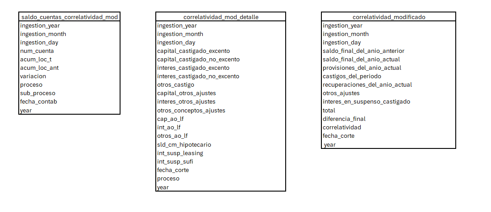
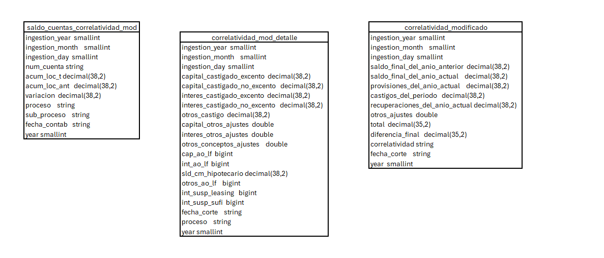
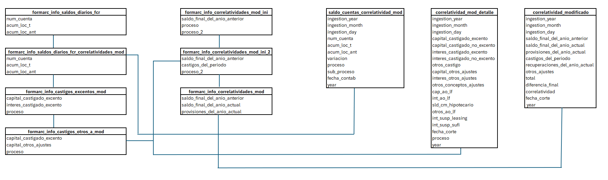

# Introducción

Esta ETL genera la correlatividad del segmento modificado del banco, articulando las cuentas de capital, intereses y otros conceptos. Se contempla el impacto de eventos como castigos, ventas de cartera, condonaciones y recuperaciones, con el fin de reflejar de manera integral la dinámica contable y financiera. Esta correlación permite una trazabilidad clara entre los movimientos operativos y sus efectos en las distintas cuentas, facilitando el análisis y la gestión eficiente.

# Objetivo

Establecer una correlatividad clara y estructurada entre las cuentas de capital, intereses y otros conceptos del segmento modificado, incorporando los efectos de castigos, ventas de cartera, condonaciones y recuperaciones. Esta correlación busca garantizar la trazabilidad contable de los movimientos, facilitando su interpretación y análisis por parte del área de Estados Financieros, y asegurando la consistencia en la presentación de la información financiera.

# Impactos técnicos

Debido a la cantidad de tablas y registros que contienen los insumos, los cruces y la periodicidad de ejecución que necesitan los diferentes equipos consumidores de la información, es necesario calendarizar la rutina.

# Tablas de salida

 

# Componentes del diagrama conceptual

Función de los archivos

Basándose en la estructura anterior, el funcionamiento de los archivos del árbol de carpetas es el siguiente:
# .pypirc
Archivo de configuración con la información necesaria para que Azure DevOps despliegue en Artifactoy la librería.
# MANIFEST.in
Determina cuáles archivos componen el paquete y deben importarse, porque se requieren para invocarlos en el paquete. Por ejemplo, se incluyen los .sql, .json y .py que se requieran para que el proceso ejecute sin problema.
# versioneer.py
Versioneer es una librería de Python para manejar automáticamente las versiones de una librería.
# setup.cfg
Archivo de configuración usado por el Versioneer. Especifica dónde está el archivo con el que se maneja el versionamiento.
# setup.py
Específica al comando PIP qué debe hacer. Se especifica allí el nombre del paquete, sus autores y la ruta base relativa del paquete, la cual indica que el código fuente está en la carpeta src. También se listan todas las dependencias del paquete.

src/vsec-gsfc-correlatividad/

# ejecucion.py
Script que desencadena la ejecución. Requiere que el paquete este instalado como librería.
# modulos.py
son las clases o steps por los que va la ejecución que se crea bajo la estructura de la librería “orquestador2”. En este archivo se ejecutan los .sql y las pruebas relacionadas con los insumos.
# _version.py
Archivo requerido por la librería Versioneer para saber cómo preguntarle dinámicamente al VCS por información de versionamiento. Este archivo se coloca en un punto donde el “__init__.py” pueda importarlo.
# __init__.py
Este archivo, que hace parte de los requisitos de Python, se requiere para poder importar otros archivos, módulos y submódulos de Python.

src/vsec-gsfc-correlatividad/static/

#config.json
Archivo de configuración general para el orquestador, que indica las tareas y archivos a ejecutar y el orden en que debe hacerlo.

src/vsec-gsfc-correlatividad /static/sql/etl

# 00_demo_consulta.sql
Se crean las estructuras de las tablas finales que quedaran en zona de resultados y los tipos de datos.

# 01_saldos_diarios_fcr.sql
Se extrae información de la ingestion con fecha al cierre del mes anterior t-1 y al anterior del anterior es decir t-2 con el fin de encontrar la variacion entre las cuentas que afectan la correlatividad se usan las tablas RESULTADOS_FCR.fcr_sap_saldos_diarios_banco y resultados_vspc_serv.maestro_cuentas_correlatividad_mod.

# 02_correlatividad_ini.sql
Se extrae la información de la ultima ingestion de la tabla en zona de resultados resultados_vspc_serv.consolidado_castigos_modificado, resultados_vspc_serv.ceplex_conciliacion_castigos, , resultados_fcr.fcr_bkv_historico_trx_prestamos, resultados_ifrs9.bco_base_final, resultados_vspc_cartera.fco_datos_basicos_y_saldos_spvh_hist, resultados_leasing.informe_castigos_leasing, con el fin de desarrollar las reglas de negocio para los campos de castigos, olf leasing y ventas de cartera. 

# 03_correlatividad_fin.sql
Se extrae la información de “01_saldos_diarios_fcr.sql” con el fin de identificar las condonaciones de capital, intereses, otros conceptos y  saldos de las cuentas del balance, se realizan los cruces y operaciones necesarias con la información de “02_correlatividad_ini.sql” con el fin de generar la correlatividad para el segment full.

# 04_insert_resultados.sql
Se inserta el resultado del query anterior “03_correlatividad_fin.sql” a la tabla final en zona de resultados

# 999_limpieza.sql
Se borran todas las tablas temporales creadas en el desarollo

# Ejecución

Este proceso fue implementado usando la nueva estrategia de despliegue mediante Artifactory, disponible en este enlace. Adicionalmente, el paquete del proceso tiene la estructura descrita en este artículo.

# Estructura de tablas finales

Nota: la estructura final de las tablas en zona de resultados se describe a continuación con el nombre del campo y el tipo de dato.

# Listado de entradas y salidas respectivas

# Log y manejo de errores

La rutina genera en la carpeta logs un archivo .log, el cual toma el nombre de “aaaammdd_hhmmss_an0016001-gsfc-correlatividadmod.log”. Este archivo contiene las sentencias que se van ejecutando de la rutina, registrando la hora con la que inicia la rutina y los tiempos que toma cada ejecución. 

Grupo para el manejo de incidentes
SECCION SERV CONTABLES Y FINANCIEROS INCIDENTES FCR